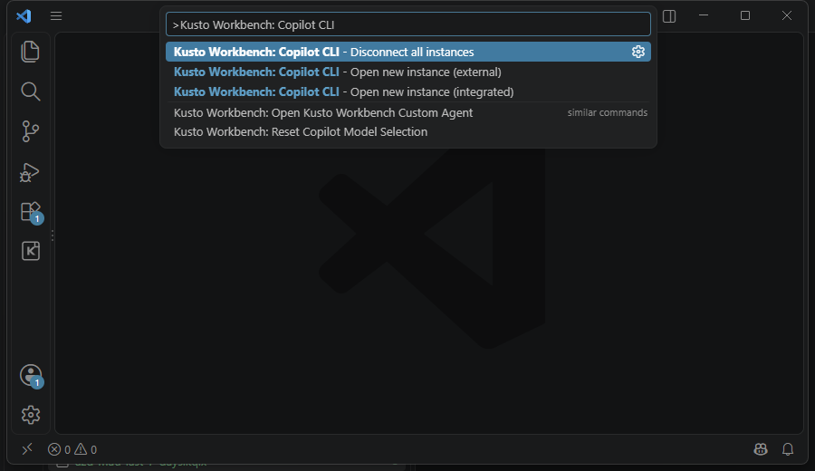

# Copilot CLI can control your live Kusto Workbench window

Enable `kustoWorkbench.copilotCli.enabled`, then run **Copilot CLI - Open new instance (integrated)** for a VS Code terminal or **Copilot CLI - Open new instance (external)** for a separate Windows console.

Both modes use the same Workbench tools, instructions, connections, and open notebooks. Run **Copilot CLI - Disconnect all instances** to revoke every CLI instance attached through that VS Code window.