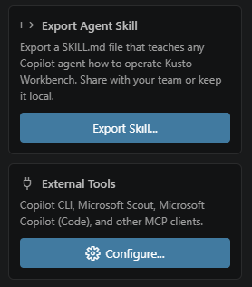

# You can build Workbench reports from external Copilot tools

Open **External Tools** below **Export Agent Skill** in Quick Access and select **Configure...**. Choose your client and VS Code profile; you can return here anytime to reconfigure the integration.

Choose **Copilot CLI** to start `copilot` normally and ask it to use Workbench, **Microsoft Scout** for automatic MCP and skill setup, or **Microsoft Copilot (Code)** for **Local Code sessions**. No separate CLI agent or `/agent` switch is needed. Close Scout before first-time setup; initialize Code before configuring it and reopen Copilot afterward. In a new Local Code session, ask to use Kusto Workbench and review its MCP approvals. The local plugin and skill may not appear in Customize even though the session can use them. Ask for a report in natural language; the client creates, edits, and saves it in an exact Workbench instance without taking over your active editor.