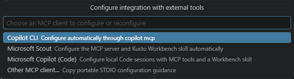

# Connect an external agent to Workbench

The external client plans your work. Kusto Workbench in VS Code supplies the tools, connections, authentication, and report editor. Setup is opt-in and does not replace your existing clients or agents.

## Before you start

- Use **local Windows x64 desktop VS Code**. WSL, SSH, containers, browser extension hosts, ARM64, Linux, and macOS are not supported by this connector.
- Install the external client you want to use. A Copilot CLI installation is separate from Microsoft Copilot's desktop Code mode.
- Open the VS Code profile that holds your Workbench connections. If you select another profile during setup, it must already contain the **same Workbench version**.
- Allow HTTPS access to **nodejs.org** for the first setup. Workbench downloads its pinned Node.js runtime, verifies its SHA-256 digest, and caches it for repair; a separate Node installation is not required.

## Run setup

1. Select **Configure external tools** in this walkthrough, or **External Tools > Configure...** in Quick Access. The Command Palette entry is **Kusto Workbench: External Tools - Configure integration...**.
2. Choose **Copilot CLI**, **Microsoft Scout**, **Microsoft Copilot (Code)**, or **Other MCP client...**. For **Vera**, choose **Copilot CLI**, then follow the Vera step without switching agents.
3. Review the consent. Setup installs a per-user local connector, installs a small startup companion in the selected VS Code profile, and enables Workbench's provider application-wide for eligible local windows.
4. Choose **Default Profile** or **Named profile...**. For a named profile, enter its exact name. This selection also controls which profile is used when a client launches a new Workbench window.
5. Follow your client's step in this walkthrough. The other client steps are alternatives, not additional requirements.

## Data and approvals

Tool inputs and results are returned to the external client. Its conversation retention, telemetry, and approval policies apply. Workbench's **Leave No Trace** controls saving new query results; it does not erase existing report data or content retained by another client.

Setup preserves existing integrations and does not grant blanket tool approvals. Review the client's requests before allowing them.